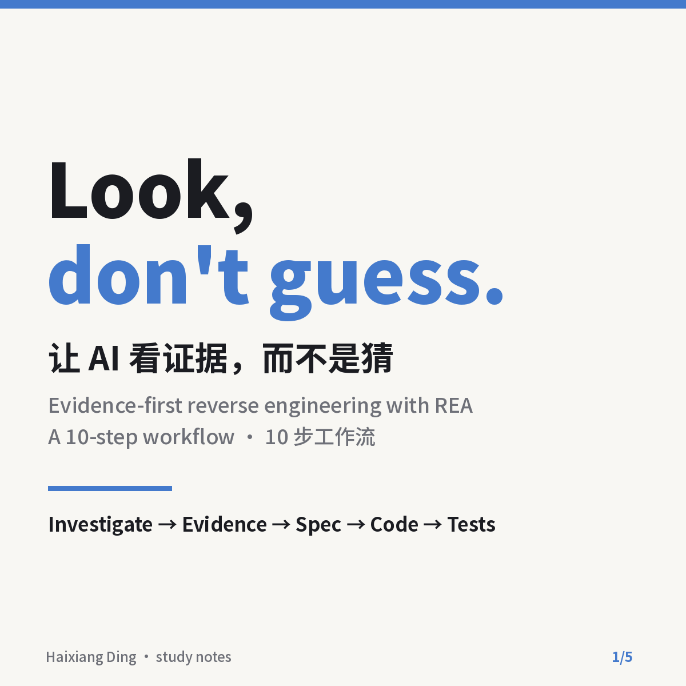
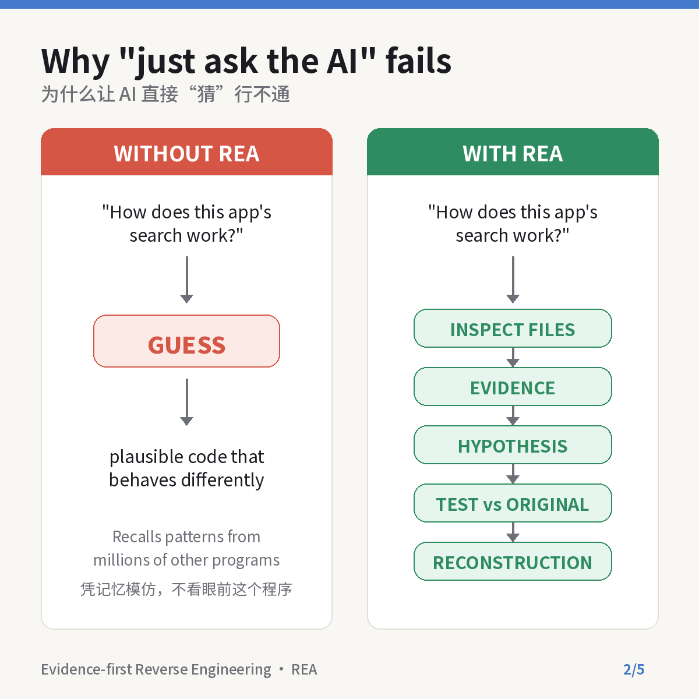
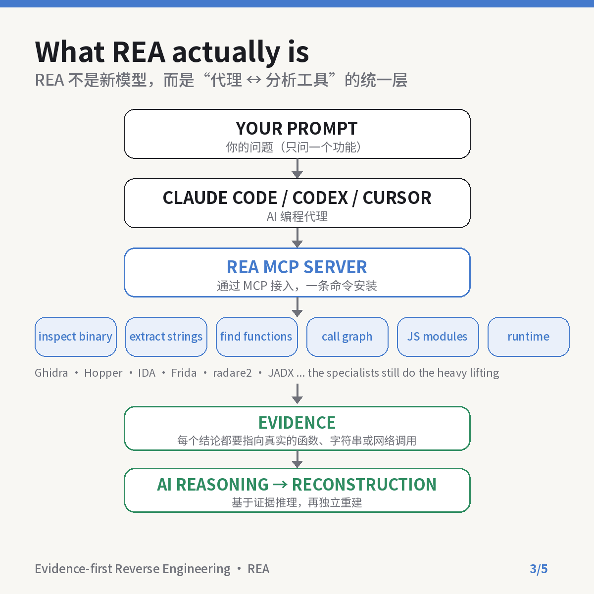
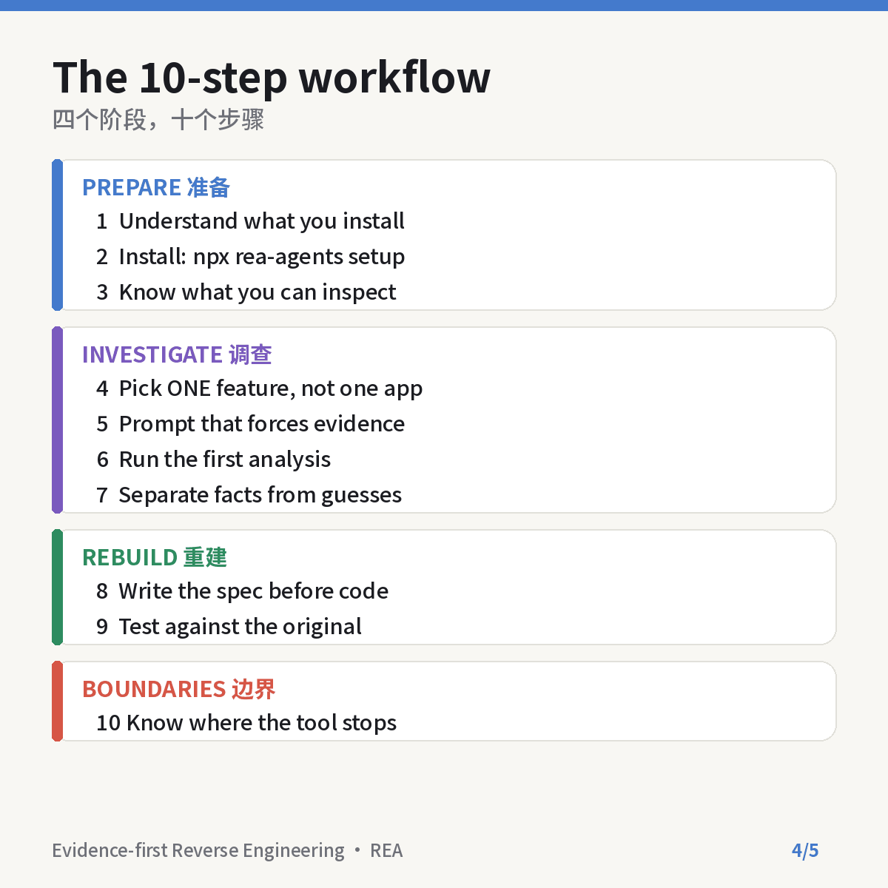
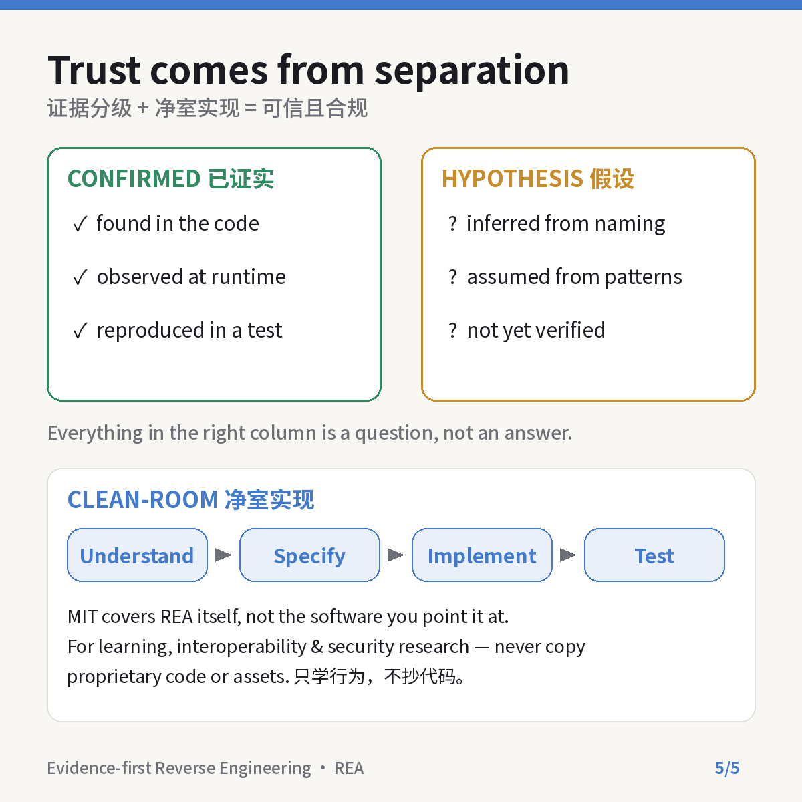

<p align="center">
  
</p>

<h1 align="center">证据优先逆向分析指南 · REA Evidence-First Guide</h1>

<p align="center">
  <strong>让 AI 看证据，而不是猜。</strong><br>
  Look, don't guess: a Chinese-first study guide to evidence-first reverse engineering with REA.
</p>

<p align="center">
  面向医生、科研人员和AI工具使用者的 <a href="https://github.com/morluto/rea">REA（Reverse Engineer Anything）</a> 中文学习笔记：四个阶段、十个步骤、证据分级与净室实现边界。<br>
  A bilingual guide to using REA with coding agents: 4 phases, 10 steps, evidence grading and clean-room boundaries.
</p>

<p align="center">
  <a href="README.md">简体中文</a> · <a href="文档/英文说明v1.0.md">English</a>
</p>

<p align="center">
  <a href="https://github.com/TUANZIDING/rea-evidence-first-guide/actions"></a>
  <a href="LICENSE"></a>
  <a href="https://github.com/morluto/rea"></a>
</p>

<p align="center">
  <code>十步工作流</code> · <code>证据优先提示词</code> · <code>事实与假设分离</code> · <code>净室实现边界</code>
</p>

<p align="center">
  <a href="#use-cases">使用场景</a> ｜ <a href="#showcase">图解一览</a> ｜ <a href="#quick-start">快速开始</a> ｜ <a href="#capabilities">能力状态</a> ｜ <a href="#contribute">参与共创</a>
</p>

<p align="center"><sub>图示为本仓库原创PNG概念图，不是REA官方素材。本仓库是独立的中文学习整理，与REA官方没有隶属关系。</sub></p>

---

<a id="use-cases"></a>

## 从你的问题进入 · Use cases

直接问AI"某个软件是怎么实现的"，得到的回答往往自信、合理，但跑起来不对：模型是在回忆千万个别的程序，而不是看眼前这一个。[REA](https://github.com/morluto/rea) 通过 MCP 把 Ghidra、Frida、JADX 等现成分析工具接到 Claude Code、Codex、Cursor 上，让代理**先检查、拿证据，再下结论，最后独立重建并用测试验证**。

| 你想做什么 | 可以怎样开始 |
| --- | --- |
| 搞清楚REA是什么、不是什么 | [十步工作流 · 阶段A](文档/十步工作流v1.0.md#prepare) |
| 第一次安装并跑通 | [快速开始](#quick-start) · [Step 2 安装](文档/十步工作流v1.0.md#prepare) |
| 研究一个应用里的某个功能 | [证据优先提示词](示例/证据优先提示词v1.0.md) · [阶段B 调查](文档/十步工作流v1.0.md#investigate) |
| 判断结论可信不可信 | [事实与假设分离](文档/十步工作流v1.0.md#investigate) |
| 看真实案例做到了什么程度 | [能力与案例](文档/能力与案例v1.0.md#cases) |
| 弄清法律与伦理边界 | [误解与边界](文档/能力与案例v1.0.md#boundary) |

<a id="showcase"></a>

## 图解一览 · Showcase

| 为什么"猜"行不通 Guess vs evidence | REA 的位置 Architecture |
| --- | --- |
|  |  |

| 十步工作流 10 steps | 证据分级与净室 Evidence and clean-room |
| --- | --- |
|  |  |

<sub>五张图均为本仓库原创，可用于教学分享，请保留署名。[素材说明](文档/素材说明v1.0.md)</sub>

<a id="quick-start"></a>

## 先用起来 · Quick start

**只想读：** 按 [十步工作流](文档/十步工作流v1.0.md) 从阶段A读到阶段D，约15分钟。

**想动手：** 需要 Node.js（22.19+ / 24.11+ / 26+）和 npm，然后：

```sh
npx rea-agents@latest setup      # 发现你的代理，展示改动，等你批准
npx -y rea-agents@latest doctor  # 出问题时自检
```

装完重启代理。入门建议先拿 Electron 应用（Notion、Obsidian、VS Code 等，底层是 JavaScript）练手：

```sh
npx -y rea-agents@latest analyze-javascript-application /absolute/path/to/app --json
```

再把 [证据优先提示词](示例/证据优先提示词v1.0.md) 粘贴给代理，只问一个功能。

[English quick start](文档/英文说明v1.0.md#quick-start) · [REA官方安装文档](https://github.com/morluto/rea/blob/main/docs/installation.md)

<a id="workflow"></a>

## 十步怎样走 · Workflow

**选一个功能 → 让代理检查并给证据 → 事实与假设分栏 → 先写行为规格 → 独立实现 → 对照原程序测试**

| 阶段 | 步骤 | 关键动作 |
| --- | --- | --- |
| A 准备 | 1–3 | 理解REA是"代理↔工具"的统一层；一条命令安装；知道哪类文件能看 |
| B 调查 | 4–7 | 一个功能而不是一个应用；强制给证据的提示词；先读结果；事实与假设分开 |
| C 重建 | 8–9 | 先写规格再写代码；用可观察行为对照原程序测试 |
| D 边界 | 10 | 不恢复源码、不自动克隆；MIT只覆盖REA本身 |

<a id="capabilities"></a>

## 当前包含什么 · Capability status

| 状态 | 内容 | 实际边界 |
| --- | --- | --- |
| 已整理 | 十步工作流中文详解、英文说明 | 依据2026-10-13原文与REA官方README重写，非原文转载 |
| 已核对 | 安装命令、Node版本要求、官方入口（2026-10-23） | REA更新很快，以 [官方仓库](https://github.com/morluto/rea) 为准 |
| 可直接用 | [证据优先提示词](示例/证据优先提示词v1.0.md)（中英两版） | 需已安装REA；只用于你拥有或获授权分析的软件 |
| 已整理 | 四个公开案例与四个常见误解 | 案例数据来自官方文档；个人构建日志单独标注 |
| 不包含 | REA源码、任何第三方软件的代码或素材 | REA请从官方仓库、rea.tools或npm包 `rea-agents` 获取 |

> **使用提醒：** 仅用于学习、互操作性、安全研究、软件保存，或分析你拥有/获授权的软件。不要复制他人的专有代码或素材；商业工具（IDA、Hopper、JEB等）须合法授权。

<details>
<summary><strong>对医学与科研人的启发 / Why a physician cares</strong></summary>

"先检查再诊断、区分已证实与疑似、用对照验证、承认不确定性"——这套循证医学的纪律，与REA的证据优先工作流高度同构。把同样的要求写进AI提示词，是让AI在临床教学与科研中真正可信的关键。

</details>

<a id="contribute"></a>

## 一起把它做得更清楚 · Contribute

欢迎补充更准确的中文译法、你自己的REA实践案例（目标、问题、证据、结果），以及失效链接报告。REA本身的问题请到 [REA官方仓库](https://github.com/morluto/rea/issues) 提交。

| 你想了解什么 | 从这里进入 |
| --- | --- |
| 十步详解 | [十步工作流](文档/十步工作流v1.0.md) |
| 可分析对象、案例、误解与边界 | [能力与案例](文档/能力与案例v1.0.md) |
| 可粘贴的提示词 | [证据优先提示词](示例/证据优先提示词v1.0.md) |
| English overview | [English homepage](文档/英文说明v1.0.md) |
| 来源、许可与署名 | [素材说明](文档/素材说明v1.0.md) |
| 本地检查 | `python3 验证/项目检查v1.0.py` |
| 本仓库的问题或建议 | [GitHub Issues](https://github.com/TUANZIDING/rea-evidence-first-guide/issues) |

---

<p align="center">
  <strong>证据优先逆向分析指南 · REA Evidence-First Guide</strong><br>
  源代码没有变得不重要，它只是不再是唯一的起点。<br>
  <a href="https://github.com/TUANZIDING">TUANZIDING</a> · <a href="LICENSE">MIT</a> · <a href="文档/素材说明v1.0.md">素材来源</a>
</p>

<sub>本仓库的原创文档、PNG图示与脚本采用MIT许可。REA为独立项目，按其自身MIT许可发布。原文观点与案例归原作者 @noisyb0y1 及REA项目，本仓库为改写整理并注明出处。</sub>
